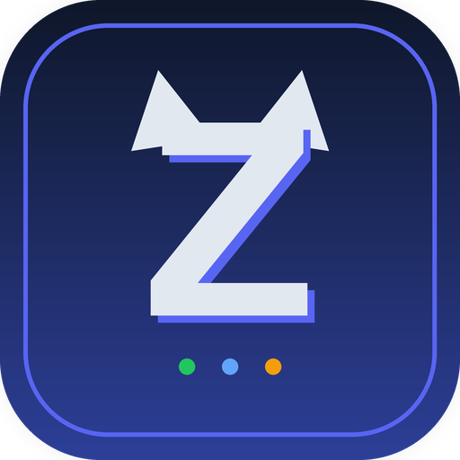

<p align="center">
  
</p>

<h1 align="center">🤖 ZENE Discord Bot</h1>

<p align="center"><b>Meme cho vui · tiện ích cho nhanh · chạy suốt ngày đêm</b></p>
<p align="center"><sub>Windows · Linux · macOS · Raspberry Pi 4 / 5 · Python 3.10+</sub></p>

<p align="center">
  🐾 Meme &nbsp;•&nbsp; 🎬 Ảnh/video &nbsp;•&nbsp; 📅 Âm lịch &nbsp;•&nbsp; ⛽ Giá xăng &nbsp;•&nbsp; 🩺 Tự hồi phục &nbsp;•&nbsp; 🍬 Dễ thêm meme
  <br><sub>📄 PolyForm Noncommercial 1.0.0 · dùng/sửa thoải mái, không bán lợi nhuận</sub>
</p>

> **💡 Mới dùng?** Đọc mục 1 (lệnh) → mục 3 (tạo bot) → mục 1 (cài đặt). Có lỗi thì nhảy tới mục 7.

---

## 🎯 Bot này làm mấy việc sau:

- Gửi meme ảnh/video khi bạn gõ đúng cụm, ví dụ gõ `siuu` là hiện video.
- Xem avatar, ghép avatar vào ảnh hài.
- Tra cứu mã phim / tên diễn viên (chỉ trong kênh NSFW).
- Xem giá xăng, âm lịch, dịch tiếng, Wikipedia.
- Tự chạy suốt ngày đêm, tự khởi động lại khi bị lỗi.

Chạy tốt trên **Windows, Linux, macOS** và **Raspberry Pi 4 / 5**.
Cần **Python 3.10 trở lên** (cài 3.11 là đẹp).

---

## 🚀 1. Chạy nhanh nếu bạn đã có bot trên Discord

Giả sử bạn đã tạo bot và có token (nếu chưa, xem mục 3).

**Windows (PowerShell):**

```powershell
git clone https://github.com/slimulv1/ZENE-discord-bot.git
cd ZENE-discord-bot
py -3.11 -m venv .venv
.\.venv\Scripts\Activate.ps1
python -m pip install -r requirements.txt
copy config.example.txt .env
notepad .env
python run.py
```

**Linux / macOS:**

```bash
git clone https://github.com/slimulv1/ZENE-discord-bot.git
cd ZENE-discord-bot
python3.11 -m venv .venv
source .venv/bin/activate
pip install -r requirements.txt
cp config.example.txt .env
nano .env
python run.py
```

Trong file `.env`, bạn **phải** điền `DISCORD_TOKEN=` bằng token bot của bạn.
Nhớ điền luôn `ZENE_OWNER_IDS=` bằng ID Discord của bạn để dùng được lệnh quản lý.

> **⚠️ Nếu Windows chặn lệnh kích hoạt `.venv`**, chạy thêm:
> `Set-ExecutionPolicy -Scope Process -ExecutionPolicy Bypass`

> **🔒 Token là bí mật.** Đây là nơi duy nhất bạn dán token. Đừng commit file `.env`,
> đừng gửi token cho ai, và nếu lỡ lộ thì Reset Token trong Discord ngay.

**Khởi động nhanh trên Windows:** chạy `.\start.ps1` trong thư mục dự án. Script đã
thiết lập sẵn các biến môi trường và chỉ **hỏi token ẩn khi chạy** — token không được
lưu vào file, nên lần sau bạn không phải dán lại cả lệnh dài:

```powershell
cd "C:\Users\slimu\Downloads\Zene Bot\ZENE-discord-bot"
.\start.ps1
```

Nếu PowerShell chặn chạy script, dùng:
`powershell -NoProfile -ExecutionPolicy Bypass -File .\start.ps1`

### Tự chạy khi Windows khởi động / đăng nhập

Chạy **một lần** (sẽ hỏi token ẩn rồi lưu vào biến môi trường USER, không ghi vào repo):

```powershell
powershell -NoProfile -ExecutionPolicy Bypass -File .\install-autostart.ps1
```

Script đăng ký Scheduled Task tên **`ZENE Bot`**, chạy `zene-autostart.ps1` mỗi lần bạn
đăng nhập. Nếu process bot thoát, script tự chạy lại sau 10 giây. Log nền tại
`logs/autostart.log` (không chứa token).

Quản lý:

```powershell
Stop-ScheduledTask -TaskName 'ZENE Bot'          # tạm dừng
Start-ScheduledTask -TaskName 'ZENE Bot'         # chạy lại
powershell -NoProfile -ExecutionPolicy Bypass -File .\uninstall-autostart.ps1   # gỡ vĩnh viễn
```

> Giới hạn: chạy **sau khi bạn đăng nhập**, không chạy khi máy chưa có phiên đăng nhập.
> Token nằm trong biến môi trường cấp user (registry Windows), không nằm trong git —
> nhưng tiến trình nào chạy bằng user đó cũng đọc được. Nếu lộ token, Reset Token ngay.

Muốn bot tự chạy lại khi tắt terminal? Xem mục 🍓 4 — cách systemd ở đó dùng được
cho cả máy Linux x86.

---

## 📜 2. Bot có những lệnh gì?

Có hai cách gọi lệnh:

- Gõ `/` rồi chọn tên lệnh, ví dụ `/amlich`. Gọi là **lệnh slash**.
- Gõ `z/` rồi tên lệnh, ví dụ `z/health`. Gọi là **lệnh prefix** (`z/` là "câu bắt đầu lệnh").

Một số lệnh dùng được **cả hai cách** — mình ghi là "cả hai" ở dưới.

### ⌨️ Lệnh trên thanh `/`

| Gõ | Bot làm gì |
|---|---|
| `/amlich` | Cho biết âm lịch hôm nay, tuổi xung, giờ tốt |
| `/avt` | Hiện ảnh đại diện của bạn (hoặc người bạn tag) |
| `/cmd` | Liệt kê cụm meme dạng ảnh/video, có nút phân trang |
| `/list` | Liệt kê **tất cả** cụm meme (cả text trigger), có phân trang |
| `/code <mã phim>` | Tra cứu phim theo mã |
| `/giaxanghomnay` | Giá xăng hôm nay |
| `/haha` | Ghép avatar của bạn vào ảnh "3 chó tuyết" |
| `/health` | Xem bot có khỏe không (uptime, ping, số server, lỗi) |
| `/idol <tên diễn viên>` | Xem thông tin diễn viên và vài tác phẩm |

`/code` và `/idol` **chỉ dùng trong kênh NSFW** (kênh bạn bật chế độ NSFW trong
Discord). Nếu thử ở kênh thường, bot sẽ nhắc bạn đổi kênh.

### 🧰 Lệnh tiện ích

| Gõ | Bot làm gì |
|---|---|
| `z/info @ai_đó` | Đưa thông tin ngẫu nhiên, kiểu đùa vui |
| `z/trans <câu>` | Dịch câu đó sang tiếng Việt |
| `z/han <câu Hán>` | Đọc Hán Việt |
| `z/wiki <từ>` | Tóm tắt Wikipedia tiếng Việt |
| `z/cmd` | Xem danh sách cụm từ meme (giống `/cmd`) |
| `z/camon @ai`, `z/non @ai` | Câu cảm ơn / đùa có tag người đó |
| `z/vanmau <chủ đề>` | Các đoạn "văn mẫu" hài hước |
| `z/anxin`, `z/xinloi`, `z/sapnupuas`, `z/samhoi`, `z/hotro` | Các câu text meme có sẵn |

> `/cmd` và `/list` đọc trực tiếp `memes.json` mỗi lần gọi — sửa file xong gõ lại
> lệnh là thấy ngay, không cần restart bot.

### 🎬 Lệnh ảnh và video

| Gõ | Bot làm gì |
|---|---|
| `z/avt`, `z/haha`, `z/tv` | Avatar / ghép avatar vào ảnh (xem ở trên) |
| `z/auzam`, `z/nohorny`, `z/bonk` | Gửi ngẫu nhiên một ảnh trong thư mục đó |
| `z/wake` | Gửi video wake |
| `z/waifu`, `z/mlem`, `z/slap` | Ảnh từ các API bên ngoài |

### 🔞 Lệnh NSFW

Chỉ dùng trong kênh đã bật NSFW:

| Gõ | Bot làm gì |
|---|---|
| `z/code`, `z/idol` | Giống `/code`, `/idol` ở trên |
| `z/hen`, `z/hentai`, `z/hentrap`, `z/henneko`, `z/henbj` | Ảnh NSFW, tối đa 10 ảnh mỗi lần |
| `z/nhentai <id>`, `z/search <từ khóa>` | Tìm doujin theo mã hoặc từ khóa |

### 🛠️ Lệnh quản lý

| Gõ | Ai được dùng | Bot làm gì |
|---|---|---|
| `z/health` | Ai cũng được | Báo bot chạy ổn không, ping bao nhiêu |
| `z/stats` | Ai cũng được | Đếm số lần meme được gọi |
| `z/extensions` | Ai cũng được | Xem phần nào đang chạy / bị lỗi |
| `z/reload <tên>` | Chủ bot | Nạp lại một phần đang lỗi |
| `z/restart` | Chủ bot | Khởi động lại bot |
| `z/shutdown` | Chủ bot | Tắt bot an toàn |

"Chủ bot" là Discord ID bạn điền vào `ZENE_OWNER_IDS`.

### 💬 Không cần gõ lệnh vẫn được

Bạn chỉ cần gõ đúng cụm trong chat, bot tự trả lời. Ví dụ:

- Gõ `tôi bị xúc phạm` → bot trả một đoạn text dài.
- Gõ `là...` → bot nói "...là Folontilô!".
- Gõ `siuu` → bot gửi video.
- Gõ `hảo hán`, `xaolon` → bot gửi ảnh ngẫu nhiên.
- Gõ `quan trọng`, `em à`, `trời mưa` → bot gửi video tương ứng.

Toàn bộ nội dung này nằm trong một file duy nhất: `zene/data/memes.json`.

> **🍬 Muốn thêm meme của riêng bạn?** Nhảy tới mục 8. Sửa JSON, rồi nhớ restart
> **cả process** — lệnh `z/restart` là chưa đủ.

---

## 🆕 3. Tạo bot trên Discord (nếu chưa có)

1. Vào <https://discord.com/developers/applications> → bấm **New Application**, đặt tên.
2. Vào tab **Bot** → bấm **Reset Token** → copy token. Token chỉ hiện lúc này,
   dán ngay vào file `.env` nhé.
3. Vẫn ở tab Bot, bật **Message Content Intent**. Nếu không bật, bot sẽ không đọc
   được lệnh `z/...`.
4. Vào **OAuth2 → URL Generator**:
   - Tick ô `bot` và `applications.commands` (ô thứ hai để có lệnh `/`).
   - Trong phần Bot Permissions, tick: *Send Messages*, *Embed Links*,
     *Attach Files*, *Read Message History*, *Use Slash Commands*.
5. Copy cái link hiện ra, mở trình duyệt, chọn server của bạn → **Add Bot**.
6. Vào settings kênh định dùng `code`/`idol`/`hen...` → bật **NSFW**.
7. Lấy ID của bạn: bật **Developer Mode** trong Discord, chuột phải vào tên bạn
   → **Copy User ID**, rồi dán vào `ZENE_OWNER_IDS` trong `.env`.

Lệnh `/` đôi khi không hiện ngay sau khi thêm bot. Cứ đợi vài phút, hoặc tắt bot
rồi bật lại. Bot đã tự đồng bộ lệnh lúc khởi động.

---

## 🍓 4. Cài trên Raspberry Pi 4 / 5

Dùng **Raspberry Pi OS 64-bit (Bookworm)**. Pi 4 nhớ bản RAM 2GB trở lên; Pi 5 thoải mái.

### 🐍 Cài Python và công cụ

```bash
sudo apt update && sudo apt full-upgrade -y
sudo apt install -y python3 python3-venv python3-pip git curl
python3 --version
```

Nếu muốn điều khiển từ máy khác, bật SSH:
`sudo raspi-config` → *Interface Options → SSH*.

### ⬇️ Cài bot

```bash
cd ~
git clone https://github.com/slimulv1/ZENE-discord-bot.git
cd ZENE-discord-bot
python3 -m venv .venv
source .venv/bin/activate
pip install --upgrade pip
pip install --only-binary=:all: -r requirements.txt
cp config.example.txt .env
nano .env
python run.py
```

Cái `--only-binary=:all:` giúp không phải tự biên dịch Pillow/numpy trên ARM
(rất lâu). Nếu Pi vẫn hơi ì, thêm `ZENE_LOG_LEVEL=WARNING` vào file `.env`.

### ♻️ Cho bot tự chạy khi khởi động

Tạo file `/etc/systemd/system/zene-bot.service`:

```ini
[Unit]
Description=ZENE Discord Bot
After=network-online.target
Wants=network-online.target

[Service]
Type=simple
User=pi
WorkingDirectory=/home/pi/ZENE-discord-bot
EnvironmentFile=/home/pi/ZENE-discord-bot/.env
ExecStart=/home/pi/ZENE-discord-bot/.venv/bin/python /home/pi/ZENE-discord-bot/run.py
Restart=always
RestartSec=5
KillSignal=SIGTERM
TimeoutStopSec=30

[Install]
WantedBy=multi-user.target
```

Rồi chạy:

```bash
sudo systemctl daemon-reload
sudo systemctl enable --now zene-bot
sudo systemctl status zene-bot
journalctl -u zene-bot -f
```

Muốn tạm dừng: `sudo systemctl stop zene-bot`. Muốn khởi động lại:
`sudo systemctl restart zene-bot`.

### 🐳 Cách Docker (dùng được cả x86 lẫn ARM)

```bash
cp config.example.txt .env
docker compose up -d --build
docker compose logs -f
```

Bot sẽ tự restart nếu chết, và có thể kiểm tra tại `http://localhost:8080/health`.

---

## ⚙️ 5. File `.env` là gì?

Đây là nơi bạn cất token và các cài đặt. Tạo bằng cách copy `config.example.txt`
đổi tên thành `.env`. **Không commit file này lên GitHub.**

Những cái quan trọng nhất:

| Dòng | Bạn cần biết |
|---|---|
| `DISCORD_TOKEN=` | Bắt buộc. Dán token bot vào đây. |
| `ZENE_OWNER_IDS=` | ID Discord của bạn, để dùng `z/restart`, `z/shutdown`… |
| `ZENE_PREFIXES=` | Câu bắt đầu lệnh. Mặc định là `z/`, `Z/`, `h/`, `H/`. |
| `ZENE_LOG_LEVEL=` | `INFO` là vừa đủ. Đổi `WARNING` nếu thấy log quá nhiều. |
| `HEALTH_PORT=` | Cổng kiểm tra sức khỏe, mặc định `8080`. Đặt `0` để tắt. |

Mấy cái nâng cao (không cần đụng nếu mới dùng):

| Dòng | Làm gì |
|---|---|
| `ZENE_MEMBERS_INTENT=` | Bật khi bạn cần quyền thành viên; mặc định `false`. |
| `ZENE_IGNORE_BOTS=` | `true` để bot không phản hồi bot khác (tránh tự chọc nhau). |
| `ZENE_TRIGGER_COOLDOWN=` | Mỗi người phải đợi bao nhiêu giây trước khi lại gửi meme. Mặc định `1.5`. |
| `ZENE_MAX_RESTARTS=` | Tối đa 10 lần tự khởi động lại rồi dừng, tránh lặp vô hạn. |
| `ZENE_DIGEST_CHANNEL_ID=` | ID kênh nhận bản tin âm lịch + giá xăng mỗi sáng. `0` là tắt. |
| `ZENE_DIGEST_HOUR=` / `ZENE_DIGEST_MINUTE=` | Giờ phát bản tin, mặc định 6:30. |
| `ZENE_DIGEST_TIMEZONE=` | Múi giờ, mặc định `Asia/Ho_Chi_Minh`. |
| `ZENE_DIGEST_PING=` | `true` thì bản tin có `@everyone`. Mặc định `false`. |
| `DMM_API_ID=` / `DMM_AFFILIATE_ID=` | Chỉ cần nếu bạn bật cog DMM (mặc định tắt). |

Xem `config.example.txt` để có file mẫu đầy đủ.

---

## 🩺 6. Kiểm tra bot có khỏe không

Mở trình duyệt vào:

```
http://127.0.0.1:8080/
```

Bạn sẽ thấy trang trạng thái dễ nhìn: bot có khỏe không, chạy được bao lâu,
đã restart mấy lần, meme được gọi bao nhiêu lần, phần nào đang lỗi. Trang tự
cập nhật 5 giây một lần và dùng được cả trên điện thoại.

Nếu chỉ muốn dữ liệu dạng JSON (Docker healthcheck dùng cái này), mở:

```
http://127.0.0.1:8080/health
```

Thấy `status: ok` là tốt. Thấy `degraded` hoặc `503` nghĩa là bot chưa sẵn sàng
hoặc có phần bị lỗi — xem log.

Hai endpoint nhỏ cho hệ thống giám sát:

- `/live` — chỉ trả lời "process còn sống", luôn `200` nếu server trả lời được.
- `/ready` — `200` khi bot sẵn sàng nhận lệnh, `503` khi có phần bắt buộc hỏng.
  Docker healthcheck dùng `/health`; bạn có thể dùng `/ready` cho monitor riêng.

Trong Discord gõ `z/health` và `z/extensions` cũng được.

Log nằm ở `logs/zene.log`. Bot tự xóa log cũ và tự che token khi ghi log.

---

## 🆘 7. Khi có lỗi

| Bạn thấy | Hiểu là | Làm gì |
|---|---|---|
| `PrivilegedIntentsRequired` | Bot chưa được bật quyền đọc tin nhắn | Vào Developer Portal bật **Message Content Intent** |
| `LoginFailure` | Token sai hoặc cũ | Reset Token, dán token mới vào `.env` |
| Không thấy lệnh `/` | Bot thiếu quyền app command | Tick `applications.commands` rồi mời bot lại; đợi vài phút |
| `/code` bảo dùng kênh NSFW | Kênh đó chưa bật NSFW | Settings kênh → bật NSFW |
| Gõ `z/...` không được | Prefix sai hoặc chưa bật intent | Kiểm tra `ZENE_PREFIXES` và Message Content Intent |
| `z/code` không có ảnh | av-wiki không có ảnh, bot đang fallback | Cần điền `DMM_API_ID` và `DMM_AFFILIATE_ID` để lấy ảnh từ FANZA |
| Dịch ra nguyên tiếng Nhật | Google chặn tạm (429) | Đợi rồi thử lại |
| `z/extensions` báo failed | Một cog lỗi | `z/reload <tên>` hoặc restart bot |
| Health trả 503 | Bot chưa READY hoặc cog lỗi | Xem `logs/zene.log` |

---

## 🍬 8. Tự thêm meme

Xem hướng dẫn đầy đủ tại **[docs/ADD_MEMES.md](docs/ADD_MEMES.md)**.

Nói ngắn gọn: sửa file `zene/data/memes.json`, kiểm tra lại bằng
`python -m json.tool zene/data/memes.json`. **Không cần restart** — bot tự phát hiện
file thay đổi (mỗi ~30 giây, có jitter nhỏ) và nạp lại ngay: trigger mới có tác dụng, asset mới load,
cooldown được dựng lại. Nếu file đang ghi dở hoặc sai cấu trúc, bot giữ dữ liệu cũ và
ghi cảnh báo vào log thay vì crash.

Bạn cũng có thể ép nạp ngay bằng lệnh `z/reloadmemes` (owner only). Tắt tự nạp bằng
`ZENE_RELOAD_ON_CHANGE=false` nếu muốn kiểm soát tay. Đổi chu kỳ kiểm tra bằng
`ZENE_RELOAD_POLL_SECONDS` (mặc định `30`, tối thiểu `5`).

> 🧟 Muốn sửa cog legacy `zene/communicate.py`? Xem ngắn gọn ở
> **[docs/ADD_MEMES.md — mục 7](docs/ADD_MEMES.md#7-sửa-communicatepy-legacy)**.

---

## 🧑‍💻 9. Cho người muốn sửa code

```bash
pip install ruff
python -m ruff check .
python -m ruff format .
python -m unittest discover -s tests -v
```

Ba nguyên tắc nhỏ: không commit `.env`, không ghi token vào log, và mọi gọi mạng
phải có timeout. Mạng/chạy nền đã có sẵn trong `zene_core/net.py` và `resilience.py`.

Cấu trúc thư mục chính:

```
run.py                  chạy bot bản production
main.py                 bản cũ, giữ để rollback
zene_core/              phần lõi (config, bot, supervisor, các cog…)
zene/data/memes.json    toàn bộ nội dung meme
zene/                   cog cũ (NSFW, wiki, dịch…)
dmm/                    client DMM đã vá
docs/ADD_MEMES.md       hướng dẫn thêm meme
tests/                  unit test
```

> `main.py` và `zene/communicate.py` là bản legacy, chỉ giữ để rollback.
> Chạy production luôn dùng `run.py`.

---

## 🖼️ 10. Tự động sửa embed link social media

Bot tự nhận link trong tin nhắn và reply lại bằng gallery ảnh/video, thay vì để
Discord hiển thị preview bị lỗi. Tính năng này đã **bật sẵn trong template**.

### Bật nhanh

Không cần chỉnh gì thêm — chỉ copy template rồi điền `DISCORD_TOKEN`

```powershell
copy config.example.txt .env
notepad .env   # chỉ cần điền DISCORD_TOKEN
```

Template đã có sẵn:

```
ZENE_MEDIA_LINKS_ENABLED=true
ZENE_MEDIA_ALLOWED_DOMAINS=x.com,instagram.com,facebook.com,tiktok.com,youtube.com
ZENE_MEDIA_USE_PROXIES=true
ZENE_MEDIA_AUTO_TRANSLATE=true
```

Nếu chỉ muốn hiển thị thumbnail, đổi `ZENE_MEDIA_USE_PROXIES=false`.

> Điền **tên miền gốc**, không có `www.`. Ví dụ `x.com` chứ không phải `www.x.com`.

### Kết quả theo từng mạng

| Mạng | Không bật proxy | Bật proxy |
|---|---|---|
| X / Twitter | Ảnh hoặc video nếu HTML có mp4 | Video mp4 qua API `api.fxtwitter.com` |
| Instagram | Ảnh thumbnail | Video mp4 qua `ifx.up.railway.app` |
| Facebook | Ảnh thumbnail | Video mp4 qua `facebed.com` |
| TikTok | Ảnh thumbnail | Video mp4 qua `offload.tnktok.com` |
| YouTube | Ảnh thumbnail | Giữ nguyên thumbnail |

Bot gửi ảnh/video bằng **Discord Components V2** (`MediaGallery`). Nếu có nhiều ảnh
trong một bài, bot gộp tối đa 10 ảnh vào cùng một gallery.

### Bot "đóng vai" bạn

Mặc định bot reply bên dưới tin nhắn link. Để bot gửi lại **mang tên và avatar của bạn**:

```
ZENE_MEDIA_MODE=impersonate
```

Bot cần thêm quyền **Manage Webhooks** và **Manage Messages** (mời lại bot bằng link trong phần tạo bot). Khi đó bot tạo một webhook mang tên/avatar bạn, gửi embed đã sửa rồi xoá tin nhắn link gốc.

> Discord **không cho** đặt message mới vào đúng vị trí tin nhắn cũ — message mới vẫn nằm ở cuối kênh, nhưng hiển thị tên/avatar của bạn nên trông như đã thay thế.

Có thể dán sẵn webhook của riêng bạn qua `ZENE_MEDIA_WEBHOOK_URL` nếu bot không có quyền tạo webhook.

### Điều khiển từng link

Đặt ký tự trước link:

| Gõ | Tác dụng |
|---|---|
| `文` | Dịch lại nội dung (mặc định bot đã tự dịch) |
| `es:` | Dịch sang tiếng Tây Ban Nha (đổi mã ngôn ngữ tuỳ ý) |
| `\|\|` | Ẩn ảnh/video thành spoiler |
| `~` | Ẩn phần trích dẫn |
| `^` | Giữ lại phần trả lời gốc |

Ví dụ: `文 es: || https://x.com/user/status/123`

### Lưu ý nhỏ

- Mỗi người chỉ được kích hoạt 3 giây/lần; tối đa 3 link trong một tin nhắn.
- Link phải nằm trong `ZENE_MEDIA_ALLOWED_DOMAINS`, nếu không bot bỏ qua.
- Ảnh/video nhạy cảm chỉ hiện trong kênh đã bật NSFW.
- Bot bỏ qua tin nhắn từ bot khác, và tự bỏ qua link đã xử lý trong 5 phút.
- Tiêu đề/nội dung link **tự động dịch sang tiếng Việt**. Tắt bằng `ZENE_MEDIA_AUTO_TRANSLATE=false`.

> Cần **discord.py >= 2.6**. Thiết kế chi tiết và kết quả test tại
> [docs/SOCIAL_MEDIA.md](docs/SOCIAL_MEDIA.md).

---

## 📄 Bản quyền

Repo dùng giấy phép **PolyForm Noncommercial 1.0.0** (mã SPDX: `PolyForm-Noncommercial-1.0.0`).

Nói đơn giản:

- ✅ Bạn được **dùng, sửa, fork, chia sẻ** cho mục đích không kiếm lời: cá nhân, học tập, giải trí, server cộng đồng…
- ✅ Khi phát hành lại, giữ dòng `Required Notice` và file [LICENSE](LICENSE).
- ❌ **Không được bán bot**, thu tiền cung cấp dịch vụ bot, hoặc đưa vào sản phẩm thương mại.
- Muốn dùng thương mại → liên hệ chủ repo để xin giấy phép riêng.

Toàn văn nằm trong file [LICENSE](LICENSE). Đây **không phải** giấy phép "open source" theo OSI vì có điều kiện phi thương mại.

---

<p align="center">
  
  <br>
  <sub>Làm bằng 🐾, chạy bằng ☕, giữ bằng 🩺 tự hồi phục.</sub>
</p>
