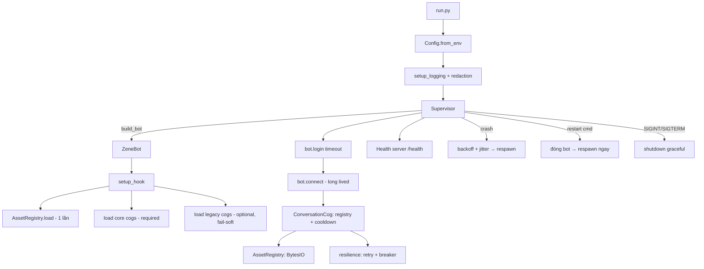

# ZENE Bot — bản thiết kế chịu lỗi 24/7

> Mục tiêu: bot không bao giờ "chết im lặng". Khi một phần hỏng, phần còn lại vẫn
> phục vụ, tự sửa hoặc tự khởi động lại có kiểm soát.

## 0. TL;DR

| | Trước | Sau |
|---|---|---|
| Entry point | `main.py` (blocking boot, `os.execv`) | `run.py` → `Supervisor` |
| Config | `TOKEN.json` + hardcode | env vars, immutable `Config`, redaction log |
| Nạp lệnh | `pd.read_excel` **mỗi tin nhắn** | 1 lần lúc `setup_hook()` |
| Phân phối tin nhắn | ~25 nhánh `if` tuần tự | registry O(1) + contains/regex đã compile |
| File ảnh | ghi chung `cache.jpg` (race condition) | `BytesIO` in-memory, không ghi file |
| Lỗi extension | in ra rồi bỏ qua | fail-soft + danh sách degraded + `/reload` |
| Network | `requests.get` không timeout | timeout + retry + circuit breaker |
| Restart | `os.execv(... 'python' ...)` | `bot.close()` → supervisor tự respawn |
| Quan sát | `print()` | JSON log xoay vòng + `/health` HTTP |

---

## 1. Phát hiện (verified — đọc trực tiếp source trước khi sửa)

| # | Vấn đề | Bằng chứng | Mức |
|---|---|---|---|
| 1 | Block event loop lúc boot bằng `time.sleep()` trong async | `main.py:36-37` | Blocker |
| 2 | Restart gọi lệnh `python` không tồn tại trên PATH | `main.py:42`; `where python` chỉ trả về alias Store | Blocker |
| 3 | `Intents.all()` đòi privileged intents | `main.py:15-16` | Blocker |
| 4 | 3 extension không có source (chỉ còn `.pyc`) | `extensions.txt:7,8,10` vs danh sách `*.py` | Blocker |
| 5 | Lệnh `waifu` đăng ký 2 lần → xung đột cog | `zene/hentai_interact.py:115` + `zene/waifu.py:9` | Blocker |
| 6 | Đọc/parse Excel trên **mọi** tin nhắn | `zene/communicate.py:97-103` | Hiệu năng |
| 7 | Bot tự phản hồi bot khác → nguy cơ loop | `zene/communicate.py:17` (không có `author.bot` guard) | Hiệu năng |
| 8 | 2 lệnh cùng ghi `cache.jpg` | `zene/communicate.py:128,142` | Race |
| 9 | `discord.File(path)` không đóng handle | `zene/communicate.py:21,55,71,...` | Rò rỏ FD |
| 10 | HTTP blocking, không timeout | `zene/hentai_interact.py:24,46,...` | Treo vô hạn |
| 11 | `hentai` bỏ qua kiểm tra NSFW | `zene/hentai_interact.py:36-52` (trước sửa) | An toàn |
| 12 | Đọc token theo CWD + mỗi lệnh DMM | `main.py:13`, `dmm_tracker.py:21,124` | Config |
| 13 | Điều kiện `and` sai logic | `zene/information.py:19` | Logic |
| 14 | Sửa global state thư viện | `zene/wiki.py:5` | Logic |

Phát hiện bổ sung: repo commit cả `TOKEN.json` (thông tin nhạy cảm) và ~50 file
`.pyc` của Python 3.9/3.10/3.11 — cả hai nên đưa vào `.gitignore` khi migrate.

## 2. Kiến trúc (over-engineering có chủ đích)



### 2.1 Năm cơ chế cốt lõi

1. **Config bất biến** (`zene_core/config.py`): mọi giá trị từ env, validate lúc
   khởi động; token có `repr=False` và bị filter khỏi log. Thiếu token ⇒ fail-fast
   kèm thông báo, không retry vô hạn.
2. **Fail-soft extension loading** (`bot.py:_load_extension`): core cog lỗi ⇒ log
   `ERROR`; legacy cog lỗi ⇒ `WARNING` + ghi vào `failed_extensions`; `/reload`
   cho phép sửa nóng. Bot vẫn READY.
3. **Resilience** (`zene_core/resilience.py` + `zene_core/net.py`): `RetryPolicy`
   (exponential + jitter), `CircuitBreaker` CLOSED→OPEN→HALF_OPEN, `TokenBucket`,
   `with_timeout`. `net.fetch_json()`/`fetch_text()` là cầu nối đưa mọi HTTP
   blocking của legacy cog qua `asyncio.to_thread()` + breaker, nên cơ chế này
   **được dùng thật** chứ không phải code chết. Không có `time.sleep()` nào
   trong đường async.
4. **Asset registry** (`zene_core/assets.py`): nạp Excel 1 lần, `path_for()` chặn
   path traversal, giới hạn kích thước 8MB, gửi bằng `BytesIO` ⇒ hết race
   condition và rò rỏ file descriptor.
5. **Supervisor** (`zene_core/supervisor.py`): tách `login()` (có timeout) khỏi
   `connect()` (chạy dài); phân biệt *restart có chủ đích* / *crash* / *shutdown*;
   backoff capped + jitter chống crash-loop; health endpoint `/health` trả 503
   khi degraded để Docker/orchestrator biết.

### 2.2 Triết lý "degraded là tính năng"

| Điều kiện | Hành vi |
|---|---|
| Mất mạng | discord.py tự reconnect; `on_disconnect`/`on_resumed` ghi log |
| Resume thất bại | `on_ready` chạy lại (docs xác nhận), supervisor đếm `ready_events` |
| Login sai token / thiếu intent | Dừng ngay, log CRITICAL có hướng dẫn |
| Extension lỗi | Bot vẫn chạy, `/extensions` liệt kệ, `/reload` sửa |
| API ngoài (waifu/wiki/trans/DMM) chết | Circuit breaker mở → trả fallback text |
| Asset mất | Bỏ qua entry, trả "Asset tạm thời không khả dụng", đếm `missing_assets` |
| LệnhNSFW ngoài kênh NSFW | Từ chối (đã vá cả lệnh `hentai`) |
| Bot khác spam trigger | `ignore_bots` + cooldown per-user |
| SIGTERM / Docker stop | Đặt cờ shutdown, `bot.close()`, health trả 503 |

---

## 3. Cách chạy

```powershell
# 1) cài dependency (trong virtualenv)
python -m venv .venv
.\.venv\Scripts\Activate.ps1
pip install -r requirements.txt

# 2) cấu hình
copy config.example.txt .env
# sửa DISCORD_TOKEN trong .env

# 3) chạy bản mới
python run.py

# 4) test logic thuần (không cần discord.py)
python -m unittest discover -s tests -v

# Docker
docker compose up -d --build
curl http://localhost:8080/health
```

Lệnh operator (prefix `z/`): `health`, `stats`, `extensions`, `reload <module>`,
`restart`, `shutdown` — 4 lệnh sau yêu cầu owner.

## 4. Migration & rollback

- `main.py` **giữ nguyên**, `zene/*.py` **giữ nguyên** (trừ 2 vá nhỏ ở mục 1).
- Để rollback: chạy lại `python main.py`. Để chuyển dần: set
  `ZENE_REQUIRED_EXTENSIONS=` rồi bật từng cog.
- `extensions.txt` của legacy vẫn giữ nguyên làm tài liệu; bản mới dùng env
  `ZENE_OPTIONAL_EXTENSIONS` và đã **loại bỏ** 3 module mất source + `zene.waifu`
  (tránh trùng lệnh).
- Nên xóa `TOKEN.json` khỏi repo sau khi đưa token vào env, thêm `.gitignore`:
  `.env`, `zene/TOKEN.json`, `__pycache__/`, `logs/`.

## 5. Đánh đổi & ranh giới xác minh

- ** verified**: mọi dòng `main.py`, `communicate.py`, cog legacy đã được đọc trực
  tiếp; tài liệu discord.py qua Context7 xác nhận `setup_hook`, `on_ready` có thể
  gọi nhiều lần, `on_disconnect`, cooldown/BucketType.
- ** inferred**: hành vi runtime của code mới (chưa chạy được — xem ngay dưới).
- ** unknown / chưa verify**: máy này **không có Python thật** (`where python` chỉ
  trả alias Microsoft Store), nên không chạy được `py_compile`, unittest, hay bot
  thật. Cần chạy lệnh ở mục 3 trên máy có Python 3.10+ (dataclass `slots=True`) trước khi đưa production.
- Cố tình **không** thêm DB, queue, slash command bắt buộc, hay viết lại nội dung
  meme — giữ tương thích ngược và giới hạn diện tích cần test.
- Các legacy cog đã được chuyển sang non-blocking: `hentai_interact` dùng
  `zene_core.net.fetch_json()` (to_thread + breaker + timeout); `wiki`,
  `google_trans`, `hannom`, `dmm_tracker` dùng `asyncio.to_thread()` cho các
  gọi blocking. `dmm_tracker` ưu tiên credentials từ `Config` (env `DMM_API_ID`,
  `DMM_AFFILIATE_ID`), chỉ fallback sang file khi chạy bản legacy.
- Hạn chế còn lại: vẫn dùng thư viện `requests` ở worker thread thay vì
  `aiohttp` (Phase 2). Trên Windows native, `loop.add_signal_handler` không dùng
  được → dừng graceful bằng Ctrl+C; trên Docker/Linux SIGTERM hoạt động bình thường.

## 5b. Vòng rà soát lỗi ẩn (round 2)

| Lỗi ẩn | Cách sửa |
|---|---|
| `connect()` trả về bình thường không tăng `failures` → respawn không backoff | `supervisor.py`: mỗi lần thoát không phải shutdown/restart đều tính là crash |
| Slash command lỗi chỉ hiện "interaction failed" | `bot.py`: `tree.on_error` trả ephemeral message có phân loại cooldown/quyền/lỗi hệ thống |
| `ctx.defer()` có thể lỗi ở prefix | `amlich.py`, `giaxang.py`: bọc try/except, prefix vẫn chạy |
| `nhentai`/`search` block event loop + bare except | `zene/nhentai.py`: `asyncio.to_thread`, log cảnh báo, fallback degraded |
| `vnlunar` trả `ages` hoặc `conflicting_ages`, giờ Hoàng Đạo là list dict | `amlich.py`: đọc cả hai dạng, format từng dòng |
| Hybrid command chưa sync | `bot.py`: `tree.sync()` trong `setup_hook`, lỗi sync chỉ warning |

## 5c. Vòng rà soát critic (round 3)

| Lỗi | Cách sửa |
|---|---|
| Tín hiệu SIGTERM tới lúc đang backoff → vẫn boot bot mới, không thoát được | `supervisor.py`: check shutdown ở đầu vòng lặp + `asyncio.Event` làm backoff bị ngắt ngay |
| `failures` cộng dồn qua nhiều tuần → tự ngừng vĩnh viễn dù không crash-loop | reset `failures` nếu bot đã chạy ổn định ≥ `ZENE_STABLE_SECONDS` (mặc định 60s) |
| Test unit lỗi do parser owner ID quá strict | bỏ ID sai, chỉ raise khi không còn ID hợp lệ |
| `information.py` bare except che giấu lỗi thật | chỉ bắt `discord.HTTPException`, log warning |
| `nhentai` search trả rỗng → im lặng; SDK không timeout | thêm thông báo "Không tìm thấy" + `wait_for(..., 15)` |
| `dmm_tracker` truy cập `items[0]` không kiểm tra | helper `_first_item`/`_first_actress` + `.get()` + timeout 15s |

## 6. Ma trận quyết định thiết kế (ghi lại để tránh "over-engineer sai chỗ")

| Ý tưởng bị loại | Lý do |
|---|---|
| Thêm Redis / database | Không cần trạng thái bền vững cho bot meme |
| Chuyển toàn bộ sang slash command | Phá vỡ server đang dùng prefix `z/` |
| Tự generate nội dung meme bằng AI | Không phải yêu cầu; rủi ro an toàn nội dung |
| Retry vô hạn khi sai token | Không bao giờ tự hồi; chỉ làm ồn crash-loop |
| Force https cho `api.nekos.fun:8080` | Endpoint có thể không hỗ trợ TLS ở port đó |
