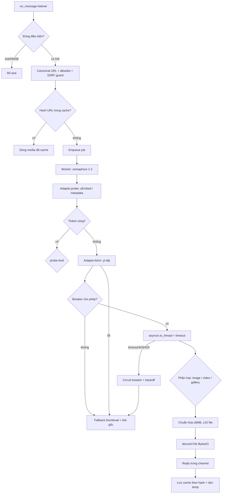

# Thiết kế: link social media → ảnh/video trong Discord

> **Phase 1 + video proxy đã implement** (`zene_core/embedfix/` + `zene_core/cogs/embedfix.py`):
> FxEmbed / ifx / facebed adapters trả mp4 trực tiếp (verify: X, IG reels, FB reel đều `video`).
> oEmbed/meta tags → Components V2 gallery, modifier, suppress, cache, breaker.
> yt-dlp adapter có sẵn nhưng mặc định tắt (`ZENE_MEDIA_USE_YTDLP=false`).
> Mục tiêu: bot tự nhận link TikTok / X / Instagram / Facebook do người dùng gửi
> và trả đúng ảnh hoặc video.

---

## 1. Sự thật cần nhớ trước

| Câu hỏi | Trả lời | Bằng chứng |
|---|---|---|
| Bot có sửa được tin nhắn của user để thay link bằng video không? | **Không.** | discord.py: `Permissions.manage_messages` — *"there are currently no ways to edit other people's messages"*; `Message.edit()` trả `Forbidden` nếu sửa message không phải của mình |
| Bot có tự unfurl link được không? | Discord tự làm qua oEmbed; bot không chiếm quyền đó | API Discord không có endpoint "edit embed của user" |
| Vậy bot làm được gì? | Gửi **message mới** (reply) kèm `discord.File`/embed; hoặc xoá message user rồi gửi lại nếu có `Manage Messages` | `Messageable.send`, `Message.delete`, `suppress_embeds` |
| Giới hạn file/embed? | 8 MB/file (bot thường), tối đa ~10 attachment, embed 6000 ký tự / 25 field / 1024 giá trị | discord.py + Discord API docs |
| yt-dlp có chạy 100% mọi link không? | **Không.** Tài liệu yt-dlp cảnh báo sites thay đổi liên tục, cách duy nhất để biết là thử | `devscripts/make_supportedsites.py` |

**Kết luận:** đây là tính năng "tốt khi chạy, nhưng phải suy thoái duyên dáng". Không bao giờ để một link hỏng làm crash bot.

---

## 2. Kiến trúc đề xuất



---

## 3. Các thành phần

### 3.1 `LinkGuard` — cổng vào

- Regex phát hiện URL (`https?://...`), tối đa **3 link/message**.
- Chuẩn hoá: lowercase host, bỏ `www.`, bỏ tracking params (`utm_*`, `igshid`, `s=`), resolve shortlink với **tối đa 3 redirect** và timeout.
- **Allowlist mặc định rỗng** — admin phải bật domain. Chặn IP private/loopback/link-local để tránh SSRF.
- Cache key = `sha256(canonical_url)`; **không log URL đầy** (có thể chứa token/private code).

### 3.2 `MediaAdapter` — interface chung

```python
class MediaAdapter(Protocol):
    domains: tuple[str, ...]
    priority: int

    async def probe(self, url: str) -> ProbeResult: ...
    async def fetch(self, url: str) -> MediaBundle: ...
```

| Adapter | `probe()` | `fetch()` | Ghi chú |
|---|---|---|---|
| `OfficialOEmbed` | gọi oEmbed công khai, lấy `type`, `title`, `thumbnail_url` | chỉ trả ảnh/embed | rẻ, an toàn nhất |
| `YtDlpAdapter` | `extract_info(download=False)` lấy `_type`, `duration`, `ext`, `formats`, `thumbnails` | `extract_info(download=True)` với `outtmpl`, `format`, `logger` | mạnh nhưng dễ vỡ; cần probe thực tế |
| `ThumbnailFallback` | — | lấy ảnh thumbnail/public image | luôn có để fallback cuối |

Mỗi adapter có **circuit breaker riêng** (`net.get_breaker("tiktok")`, `"instagram"`, …) để một site chết không kéo site khác.

### 3.3 `MediaClassifier` — trả "đúng ảnh hoặc video"

Dùng field từ `info_dict`/oEmbed:

| Kết quả | Điều kiện | Hành động |
|---|---|---|
| `image` | oEmbed `type=photo`, hoặc info có `ext` ảnh, không có `vcodec` | đưa URL vào `MediaGallery` (1 item) |
| `video` | có `vcodec` / `duration` / `format` video | đưa URL vào `MediaGallery` (1 item); chỉ tải/transcode khi fallback |
| `gallery` | có `image_urls`/`thumbnails` nhiều phần (carousel Instagram/TikTok photo post) | tối đa 10 item trong 1 `MediaGallery` |
| `none` | không xác định được | fallback thumbnail + link gốc |

Nếu video > 8MB: FFmpeg transcode với budget (ví dụ 720p, 1.2 Mbps, tối đa 45s). Vẫn vượt → gửi thumbnail + link.

### 3.4 `MediaWorker` — luồng bất đồng bộ

- `asyncio.Queue` + `Semaphore(1–2)` → không tải nhiều link cùng lúc.
- `asyncio.to_thread()` cho yt-dlp/FFmpeg (blocking), bọc `asyncio.wait_for(..., 20–30s)`.
- `tempfile.TemporaryDirectory()` + `finally: cleanup` — không để rác trên Pi.
- Dedupe theo hash: cùng 1 link trong TTL không tải lại.

### 3.5 `DeliveryPolicy`

| Chế độ | Hành vi | Rủi ro |
|---|---|---|
| `reply` (mặc định) | reply message mới kèm media | an toàn, không cần quyền đặc biệt |
| `replace` | xoá message user rồi gửi lại | cần `Manage Messages`; ghi audit; **opt-in từng guild** |

Không bao giờ mặc định `replace`.

---

## 4. Ma trận suy thoái

| Tình huống | Bot làm gì |
|---|---|
| Domain không trong allowlist | Bỏ qua hoàn toàn |
| Shortlink redirect về IP private | Chặn, log hash, bỏ qua |
| oEmbed trả `type=photo` | Gửi ngay message V2 gồm `TextDisplay` + `MediaGallery` thumbnail |
| yt-dlp hỏng extractor | Breaker mở → fallback thumbnail + link |
| Video > 8MB | Transcode; nếu vẫn to → thumbnail + link |
| 403/429 từ platform | Backoff jitter, tạm quarantine domain |
| Rate limit Discord | discord.py tự xử lý; worker giới hạn concurrency |
| Link NSFW trong kênh thường | Không tải, nhắc chuyển kênh NSFW |
| Bot bị spam link | Cooldown per-user + max 3 link/message + queue có `maxsize` |
| oEmbed trả URL độc hại (http://IP private) | Validate scheme `https` + host public trước khi đưa vào `MediaGallery` |
| URL media CDN hết hạn (signed URL) | Cache TTL ngắn hoặc re-probe khi gửi thấy 403 |
| Không biết media có nhạy cảm không | Mặc định coi là NSFW, chỉ gửi ở kênh age-restricted |

---

## 5. Cấu hình đề xuất

| Biến | Mặc định | Ý nghĩa |
|---|---|---|
| `ZENE_MEDIA_LINKS_ENABLED` | `false` | Bật/tắt toàn tính năng |
| `ZENE_MEDIA_ALLOWED_DOMAINS` | rỗng | Danh sách domain được phép |
| `ZENE_MEDIA_MODE` | `reply` | `reply` hoặc `replace` |
| `ZENE_MEDIA_MAX_LINKS` | `3` | Số link tối đa mỗi message |
| `ZENE_MEDIA_MAX_BYTES` | `8388608` | Giới hạn file (theo Discord) |
| `ZENE_MEDIA_TIMEOUT` | `25` | Timeout tải một link |
| `ZENE_MEDIA_CACHE_TTL` | `3600` | TTL cache theo hash URL |
| `ZENE_MEDIA_WORKERS` | `1` | Số worker tải cùng lúc |
| `ZENE_MEDIA_QUEUE_SIZE` | `32` | Giới hạn hàng đợi, vượt thì bỏ link + đếm `dropped` |
| `ZENE_MEDIA_STRICT_NSFW` | `true` | Không rõ nhạy cảm thì coi như NSFW |

> Components V2 (`LayoutView`/`MediaGallery`) cần **discord.py >= 2.6**.
> `requirements.txt` đã nâng mức tối thiểu; bản 2.0–2.5 sẽ lỗi ngay khi import cog.

---

## 6. Pháp lý & quyền riêng tư

- Tải và đăng lại video YouTube/Instagram/TikTok/Facebook thường **vi phạm ToS** của các nền tảng và có thể vi phạm bản quyền. Đây là rủi ro **chính sách**, không phải lỗi code.
- X API hiện **pay-per-use** (docs.x.com), nên oEmbed/third-party là lựa chọn thực tế hơn cho link X.
- Tài liệu TikTok bị chặn từ mạng này → khả năng oEmbed TikTok là **unknown**, cần verify lại trước khi implement.
- Mặc định **tắt**, bật theo guild, có disclaimer trong README, và cung cấp cơ chế opt-out cho user.

---

## 7. Lộ trình triển khai

1. **Phase 0 — đo lường:** chỉ log số link thấy được, chưa tải gì.
2. **Phase 1 — oEmbed only:** `/medialink <url>` opt-in, gửi embed thumbnail.
3. **Phase 2 — yt-dlp có allowlist:** thêm adapter, worker, breaker, transcode, cache.
4. **Phase 3 — auto trong channel đã bật:** `ZENE_MEDIA_LINKS_ENABLED=true` + chế độ `reply`.
5. **Phase 4 — replace (tuỳ chọn):** chỉ khi có `Manage Messages` và admin xác nhận.

Mỗi phase đều có feature flag để rollback ngay.

---

## 8. Bài học từ Embedded.gallery (https://embedded.gallery/)

Bot này là **embed fixer**, không phải downloader. Điểm khác biệt lớn:

| Học được | Áp dụng vào ZENE |
|---|---|
| Không tải lại media rồi upload — dùng URL media từ nền tảng trong `Embed` | Đổi ưu tiên: **oEmbed/remote URL trước**, yt-dlp chỉ làm fallback. Tránh giới hạn 8MB và rủi ro rehost |
| 2 chế độ: `Reply` (mặc định) và `Impersonate` (webhook mang tên/avatar người gửi, có watermark trừ khi Premium) | Thêm tuỳ chọn webhook, nhưng mặc định vẫn `reply` cho an toàn |
| "Ẩn preview của Discord rồi reply embed đã sửa" → nhiều khả năng dùng `Message.edit(suppress=True)`, cần `Manage Messages` | Thêm `suppress` có điều kiện theo quyền, fallback reply nếu thiếu quyền |
| Modifier ngay trong tin nhắn: `文` dịch, `~` ẩn quote, `||` spoiler, `^` hiện parent reply, `es:` chọn ngôn ngữ | Thiết kế cú pháp điều khiển per-link thay vì chỉ env cứng |
| Cấu hình theo server + channel + platform; NSFW/spoiler auto theo kênh age-restricted | Mở rộng config hiện tại theo guild/channel |
| Context: quote, parent reply, Community Notes, comment Reddit cụ thể | Adapter nên trả `context` chứ không chỉ media |
| Gallery view: ảnh + video của cùng 1 post trong 1 gallery | Dùng `discord.ui.MediaGallery` (Components V2); nếu không dùng V2 thì gửi nhiều ảnh/file trong 1 message, **không** trộn embed với V2 |
| Dịch tự động theo server/channel | Tái dùng `to_vietnamese()` hiện có |
| Freemium $1.99/server/tháng cho custom avatar, bỏ watermark, bot phản hồi bot, translation limit cao | Gợi ý mô hình bền vững nếu public bot |

**Lưu ý:** trang không công bố implementation, nên chi tiết kỹ thuật ở trên là *inferred* từ mô tả sản phẩm. Privacy policy của họ nói chỉ lưu Discord ID để debug và xử lý nội dung tin nhắn tạm thời — nên cân nhắc chính sách tương tự.

**Kết luận sửa thiết kế:** ưu tiên `embed fixer` (remote URL) hơn `downloader`. yt-dlp vẫn giữ làm fallback cho link không có oEmbed tốt.

## 10. Cách code cho đúng (đã kiểm tra API discord.py 2.7)

### 10.1 Kiểu dữ liệu

```python
from dataclasses import dataclass, field
from typing import Literal


@dataclass(frozen=True, slots=True)
class LinkContext:
    message: discord.Message
    url: str
    canonical: str
    modifiers: frozenset[str] = field(default_factory=frozenset)
    lang: str | None = None


@dataclass(frozen=True, slots=True)
class ProbeResult:
    kind: Literal["image", "video", "gallery", "none"]
    title: str
    author: str
    media_urls: tuple[str, ...]  # URL từ CDN của nền tảng
    context: str = ""  # quote / parent / community note
    nsfw: bool | None = None  # None = chưa biết → coi như NSFW
```

`media_urls` là **URL asset trực tiếp từ nền tảng** (ảnh/video), không phải URL trang
web và không phải file tải về — đây là khác biệt lớn nhất so với thiết kế yt-dlp ban đầu.
Nếu chỉ có URL trang (ví dụ link tweet) thì phải lấy `thumbnail_url` làm fallback;
`MediaGallery` cần URL tới asset (`UnfurledMediaItem` chấp nhận arbitrary URL hoặc
`attachment://<filename>` — đã verify trong docs discord.py 2.7).

### 10.2 Parser modifier

```python
LINK_RE = re.compile(r"https?://[^\s<>]+", re.I)
MOD_MAP = {"文": "translate", "~": "hide_quote", "||": "spoiler", "^": "parent"}
LANG = re.compile(r"\b([a-z]{2}(?:[-_][a-zA-Z]{2})?):", re.I)


def parse_modifiers(text: str) -> tuple[str, frozenset[str], str | None]:
    # Chỉ đọc phần KHÔNG phải URL. Nếu replace trên cả câu, một dấu '~'
    # hoặc '||' trong query string sẽ làm hỏng link.
    outside = " ".join(LINK_RE.split(text)[::2])
    mods = {name for token, name in MOD_MAP.items() if token in outside}
    cleaned = outside
    for token in MOD_MAP:
        cleaned = cleaned.replace(token, "")
    lang = None
    match = LANG.search(cleaned)
    if match:
        lang = match.group(1).lower().replace("_", "-")
        cleaned = cleaned[: match.start()] + cleaned[match.end() :]
    return cleaned.strip(), frozenset(mods), lang
```

Parser chạy trên **đoạn chữ trước mỗi link**, không phải trên chính URL. Đã sửa lỗi
trong bản trước: `parse_modifiers(raw)` với `raw` là URL thì không bao giờ thấy được
`文`, `~`, `es:` vì mấy ký tự đó nằm ngoài URL.

### 10.3 Dựng gallery bằng Components V2 (API đã verify tồn tại)

```python
def build_gallery(result: ProbeResult, spoiler: bool) -> discord.ui.LayoutView:
    view = discord.ui.LayoutView(timeout=180)
    container = discord.ui.Container(accent_colour=discord.Colour.blurple())
    text = f"**{result.title}** — {result.author}"
    if result.context:
        text += f"\n{result.context}"
    # TỔNG text trong TOÀN view <= 4000 ký tự, không phải 4000/item.
    container.add_item(discord.ui.TextDisplay(text[:4000]))

    gallery = discord.ui.MediaGallery()
    for url in result.media_urls[:10]:  # MediaGallery tối đa 10 item
        gallery.add_item(media=url, spoiler=spoiler)
    container.add_item(gallery)
    view.add_item(container)
    return view
```

Đã kiểm tra: `Container.add_item`, `LayoutView.add_item`, `MediaGallery.add_item`,
`TextDisplay` đều tồn tại; `MediaGallery.add_item` nhận `media=str|discord.File` và
`spoiler=bool`, ném `ValueError` nếu quá 10 item.

> **Đã verify từ Discord API docs + discord.py 2.7.1:** Components V2 dùng flag
> `IS_COMPONENTS_V2`; gửi `content`, `embeds`, `sticker_ids` hoặc `poll` sẽ bị
> **400 BAD REQUEST**. Discord tự bật flag khi dùng `LayoutView`.
> Giới hạn text: **4000 ký tự TỔNG** (`LayoutView.content_length()`), mỗi
> `TextDisplay` tối đa 4000. Số component: discord.py `LayoutView` enforce **40 child**,
> Discord changelog có chỗ ghi 30 → thiết kế dùng **≤30 để an toàn**.
> `LayoutView`/`Container`/`MediaGallery`/`TextDisplay` đều `versionadded:: 2.6`,
> nên `requirements.txt` đã nâng lên `discord.py>=2.6,<3.0`.

Nếu fallback phải transcode file **local** (video > 8MB), phải đính kèm file và trỏ
component tới nó — Components V2 ẩn attachment nếu không có component nào tham chiếu tới nó:

```python
file = discord.File(temp_path, filename="clip.mp4")
gallery.add_item(media="attachment://clip.mp4", spoiler=spoiler)
await message.reply(file=file, view=view)  # KHÔNG truyền embed/content
```

### 10.4 Ẩn preview của message gốc

```python
async def suppress_preview(message: discord.Message) -> bool:
    guild = message.guild
    if guild is None or not message.channel.permissions_for(guild.me).manage_messages:
        return False
    try:
        await message.edit(suppress=True)
        return True
    except (discord.Forbidden, discord.HTTPException):
        return False
```

`suppress=True` **yêu cầu Manage Messages** (đã verify trong docs `Message.edit`).
Không có quyền thì cứ reply bình thường.

### 10.5 Chế độ Impersonate (webhook)

```python
async def send_impersonated(bot, channel, author, view) -> None:
    webhook = await channel.create_webhook(name="zene-embed")  # cần Manage Webhooks
    try:
        await webhook.send(
            username=author.display_name,
            avatar_url=author.display_avatar.url,
            view=view,
            wait=True,
        )
    finally:
        await webhook.delete()
```

Có thể cache webhook theo channel thay vì tạo/xoá mỗi lần. Webhook trả về tin nhắn
**mới** mang tên người gửi — vẫn không sửa được message gốc.

### 10.6 Luồng xử lý tổng hợp

```python
async def on_message(message):
    if not cfg.enabled or message.author.bot or message.guild is None:
        return
    matches = list(LINK_RE.finditer(message.content))
    if not matches or len(matches) > cfg.max_links:
        return
    for match in matches:
        raw = match.group(0)
        _, mods, lang = parse_modifiers(message.content[: match.start()])
        try:
            # put_nowait tránh block event handler; check-then-put không atomic.
            await QUEUE.put_nowait(LinkContext(message, raw, await canonical(raw), mods, lang))
        except asyncio.QueueFull:
            STATS["dropped"] += 1
```

`canonical()` là **async** vì resolve shortlink cần I/O. Nếu muốn giữ nó thuần, hãy
chuyển bước resolve vào worker. `canonical()` phải trả URL đã validate: scheme `https`,
host nằm trong allowlist (theo **registrable domain**, dùng `tldextract`, không so sánh
chuỗi đuôi), bỏ tracking param, chặn IP private sau redirect. Ảnh/video trả về cũng
phải là asset URL `https` (hoặc `attachment://`), không phải URL trang web.

Worker: `probe()` → **dùng modifier**: `spoiler` → `build_gallery(..., spoiler=True)`;
`translate` → `to_vietnamese(result.title/context)` (hoặc theo `ctx.lang`);
`hide_quote` → bỏ `result.context`; `parent` → giữ parent reply. Nếu có `media_urls`
→ build ngay; nếu không → `fetch()` (yt-dlp trong `asyncio.to_thread` + `wait_for`)
→ build → `suppress` → reply/webhook → cache hash. Đừng để modifier chỉ được parse
rồi bỏ đi như bản trước.

### 10.7 Checklist nghiệm thu

- [ ] Unit test `parse_modifiers` với `文 es: http://... ||`, `~`, `^`.
- [ ] Unit test classifier: `image`, `video`, `gallery`, `none`.
- [ ] Smoke test `build_gallery(...).to_components()` — đảm bảo ≤10 item (đã thử: 1 container, 3 child, 2 gallery item).
- [ ] Test `suppress_preview` khi bot thiếu Manage Messages → trả `False`, không crash.
- [ ] Test breaker mở sau 3 lỗi, fallback vẫn gửi link gốc.
- [ ] Test không log URL đầy (chỉ hash).
- [ ] Test temp dir được dọn trong `finally`.
- [ ] Test modifier `文 es: ... ||` đặt **trước** URL vẫn được nhận, và `~` trong query URL không bị xoá.
- [ ] Test `MediaGallery` nhận URL `https` nhưng chặn `http://127.0.0.1/...` từ oEmbed.
- [ ] Test `view.content_length() <= 4000` với title dài + context dài (không cộng 4000/item).
- [ ] Test `nsfw=None` → chặn ở kênh thường; `nsfw=False` → cho phép.
- [ ] Test transcode local: `discord.File(...)` + `attachment://clip.mp4` hiển thị được.
- [ ] Kiểm tra môi trường có `discord.py>=2.6` trước khi import `LayoutView`.

### 10.8 Thư viện nên dùng / đã có

| Thư viện | Trạng thái | Dùng cho |
|---|---|---|
| `tldextract` | **cần thêm** (`>=3,<4`) | Lấy registrable domain đúng; tránh `evil-x.com` giả `x.com` |
| `yarl` | đã có (dependency của aiohttp) | Chuẩn hoá URL, bỏ tracking param, so sánh host |
| `aiohttp` | đã có trong `net.py` | Gọi oEmbed/API qua session chung + breaker |
| `cachetools` | đã có | TTL cache theo hash URL |
| `yt-dlp` | **chỉ thêm khi implement Phase 2** | Fallback khi oEmbed không có media URL |
| FFmpeg (binary hệ thống) | cần cài riêng trên Pi nếu bật transcode | Giảm video > 8MB; không phải pip package |

**Không cần** thêm `pydantic`/`httpx`: dataclass + `net.py` hiện tại đã đủ, tránh phình dependency trên ARM.

## 11. Kết quả test link thật

| Link | `MetaAdapter` | `YtDlpAdapter` | Kết luận |
|---|---|---|---|
| Instagram post `DgC0zNhIwR-` | `image`, 1 ảnh CDN `cdninstagram.com`, title "Jia Jia on Instagram…" | không thử | ✅ OK |
| Instagram reel `Dfy-oKtq9iO` | `image`, 1 thumbnail CDN, title "TEN on Instagram…" | lỗi: login/rate-limit, `kind=none` | ⚠️ chỉ ảnh thumbnail; muốn video cần cookies IG |
| X status `2124470814…` | `image`, 1 ảnh `pbs.twimg.com` (amplify_video_thumb) | `image`, title đầy đủ + thumb `.jpg?name=orig` | ⚠️ X không lộ `og:video` cho bot công khai; chỉ thumbnail |

Kiểm tra HTML: cả 3 link **không có `og:video`/`twitter:player`** hợp lệ, nên `MetaAdapter`
không thể trả video trực tiếp. `yt-dlp` metadata-only cũng không giải quyết được reel IG
(không có cookie) và vẫn trả thumbnail cho X. Muốn video thật cần Phase 2: tải có
cookies/FFmpeg (rủi ro ToS) — hiện **chưa implement**.

## 12. Phase 2 — lấy video thật

### 13.1 Ba hướng và lựa chọn

| Hướng | Ưu | Nhược | Quyết định |
|---|---|---|---|
| Lấy `format.url` từ `yt-dlp.extract_info(download=False)` | Không tải, rẻ | URL thường là signed/hết hạn; Discord không chắc fetch được video trang | Thử trước (`remote`) |
| Tải file rồi upload lại | Chắc hiển thị trong `MediaGallery` | Cần cookies + FFmpeg + ≤8MB; rủi ro ToS | Bật riêng (`download`) |
| Chỉ thumbnail như hiện tại | An toàn, rẻ | Không đúng yêu cầu "video" | Fallback cuối |

Chế độ mới: `ZENE_MEDIA_VIDEO_MODE = off | remote | download` (mặc định `off`).

### 13.2 Cookie = secret tuyệt đối

- `ZENE_MEDIA_COOKIEFILE=/path/outside/repo/cookies.txt` — file Netscape export từ browser,
  **không commit**, đã thêm pattern vào `.gitignore`.
- Hoặc `ZENE_MEDIA_COOKIES_FROM_BROWSER=chrome|firefox|edge` trên máy cá nhân.
- Không log nội dung cookie, không gửi cookie tới web/MCP, không đưa vào URL.
- Instagram reel test ở mục 11 lỗi vì yt-dlp báo *login required / rate limit* —
  đây là lý do chính cần cookie, không phải lỗi code.

Đã verify trong yt-dlp 2025.12.08: tham số Python là `cookiefile`,
`cookiesfrombrowser`, `merge_output_format`, `ffmpeg_location`, `postprocessor_args`
(`YoutubeDL.py` dòng 349, 350, 426, 519, 521).

### 13.3 Pipeline tải có kiểm soát

```python
opts = {
    "quiet": True,
    "noplaylist": True,
    "format": "bv*[height<=720]+ba/b[height<=720]/wv*/worst",
    "outtmpl": str(tmp / "%(id)s.%(ext)s"),
    "paths": {"temp": str(tmp)},
    "merge_output_format": "mp4",
    "cookiefile": cfg.media_cookiefile or None,
    "cookiesfrombrowser": (browser,) if browser else None,
    "ffmpeg_location": cfg.media_ffmpeg_path or None,
}


def work():
    with yt_dlp.YoutubeDL(opts) as ydl:
        info = ydl.extract_info(url, download=True)
        return Path(ydl.prepare_filename(info))


path = await asyncio.wait_for(asyncio.to_thread(work), timeout=cfg.media_timeout)
if path.stat().st_size > cfg.media_max_bytes:
    path = await transcode(path, tmp, budget=cfg.media_max_bytes, seconds=60)
file = discord.File(path, filename="clip.mp4")
gallery.add_item(media="attachment://clip.mp4", spoiler=spoiler)
await message.reply(file=file, view=view, mention_author=False)
# finally: tmp.cleanup()
```

`transcode()` gọi binary FFmpeg (`-t 60 -vf scale=-2:720 -b:v 1M -b:a 96k`), kiểm tra
kích thước lần 2; nếu vẫn vượt → bỏ file, gửi thumbnail như Phase 1.

### 13.4 Biến cấu hình mới

| Biến | Mặc định | Ý nghĩa |
|---|---|---|
| `ZENE_MEDIA_VIDEO_MODE` | `off` | `off` / `remote` / `download` |
| `ZENE_MEDIA_COOKIEFILE` | rỗng | Đường dẫn file cookie ngoài repo |
| `ZENE_MEDIA_COOKIES_FROM_BROWSER` | rỗng | `chrome` / `firefox` / `edge` |
| `ZENE_MEDIA_FFMPEG_PATH` | rỗng | Đường dẫn binary FFmpeg |
| `ZENE_MEDIA_MAX_DURATION` | `60` | Giây tối đa khi transcode |
| `ZENE_MEDIA_BITRATE` | `1M` | Bitrate video sau transcode |

Cài FFmpeg: Windows tải static build; Raspberry Pi/Linux `sudo apt install ffmpeg`.
yt-dlp đã cảnh báo máy hiện tại **không có ffmpeg** khi test reel Instagram.

### 13.5 Rủi ro chưa giải quyết được bằng code

- ToS/bản quyền: tải và đăng lại video người khác vẫn là rủi ro chính sách.
- Instagram có thể chặn IP/cloud server dù có cookie; cần thử trên IP thực tế.
- X API tính phí; yt-dlp phụ thuộc cấu trúc HTML nên có thể vỡ bất kỳ lúc nào.
- Không bao giờ bật chế độ `download` mặc định; chỉ opt-in từng server.

## 13. Phương án KHÔNG dùng yt-dlp (rewrite/proxy trực tiếp)

### 14.1 Bằng chứng đã thử

| Nguồn | Kết quả verify |
|---|---|
| X status `2124470814…` | HTML công khai chứa **9 URL `https://video.twimg.com/.../*.mp4?tag=29`** (`320x568`, `480x854`). MetaAdapter trước đó chỉ đọc og: nên bỏ sót. |
| `https://api.fxtwitter.com/SenhorZiborro/status/2124470814309486863` | `code:200`; `tweet.media.videos[0].url` = mp4 `480x854`, `thumbnail_url`, `possibly_sensitive:false`. Docs FxEmbed: X dùng prefix `fixupx.com`, Twitter dùng `fxtwitter.com`, Bluesky `fxbsky.app`. |
| `https://ifx.up.railway.app/p/DgAY0euJkFt/media/0` | `HEAD → 200, video/mp4, 7.18 MB` (< 8 MB) |
| `https://ifx.up.railway.app/p/Dfy-oKtq9iO/media/0` | `HEAD → 200, video/mp4, 2.34 MB` — reel Instagram cũng ra video |
| `https://www.facebed.com/reel/1811869953192242` | `HEAD 200 text/html`; HTML có `og:video:secure_url` trỏ tới **mp4 trên `fbcdn.net`** — đưa thẳng vào `MediaGallery` được |
| `ddinstagram.com` | DNS `getaddrinfo failed` từ mạng này → **unknown**, không dùng |

Kết luận: với 3 mạng này **không cần tải file về server, cũng không cần yt-dlp**.

### 14.2 Ba adapter mới

| Adapter | Input | Output | Delivery |
|---|---|---|---|
| `FxEmbedAdapter` (ưu tiên cho X) | `api.fxtwitter.com/{user}/status/{id}` | JSON `tweet.media.videos[0].url`, `thumbnail_url`, `possibly_sensitive` | V2 `MediaGallery` |
| `XDirectAdapter` (fallback X) | HTML X | regex `video.twimg.com/.../*.mp4`, chọn `/avc1/{W}x{H}/` có W×H lớn nhất, unescape `&amp;` | V2 `MediaGallery` |
| `IfxAdapter` | path `/p/{id}/` hoặc `/reel/{id}/` | `HEAD https://ifx.up.railway.app/p/{id}/media/{0,1,2}` → giữ URL nếu `video/mp4` và ≤ `media_max_bytes` | V2 `MediaGallery` |
| `FacebedAdapter` | URL `facebook.com`/`fb.com` | đổi host thành `facebed.com`, fetch HTML, lấy `og:video:secure_url` (fbcdn mp4) | V2 `MediaGallery`; nếu không có og:video → message content thường để unfurl |

Cần mở rộng `ProbeResult.kind` thêm `"link"` cho trường hợp facebed (không phải asset URL).
`views.build_view` chỉ dùng cho `image|video|gallery`; `link` đi qua nhánh `message.reply(content=rewritten_url)`.

> Components V2 (`TextDisplay`) **không unfurl link**, nên không nhét URL facebed vào view.

### 14.3 Biến cấu hình mới

| Biến | Mặc định | Ý nghĩa |
|---|---|---|
| `ZENE_MEDIA_USE_PROXIES` | `false` | Bật ifx/facebed (third-party) |
| `ZENE_MEDIA_PROXY_HOSTS` | `api.fxtwitter.com,ifx.up.railway.app,facebed.com` | Exact host được phép, không dùng wildcard |
| `ZENE_MEDIA_FACEBED_HOST` | `facebed.com` | Host rewrite cho Facebook |
| `ZENE_MEDIA_DIRECT_VIDEO_TTL` | `300` | Cache ngắn vì signed URL có thể hết hạn |

### 14.4 An toàn & suy thoái

- Chỉ cho phép **exact host** proxy từ config; HEAD validate `Content-Type` và `Content-Length`.
- `is_asset_url()` hiện tại chỉ nhận suffix CDN (`twimg.com`, `fbcdn.net`, …). Khi implement phải
  truyền thêm danh sách `proxy_hosts` để chấp nhận exact `ifx.up.railway.app`; nếu không,
  URL ifx sẽ bị từ chối dù HEAD trả `video/mp4`.
- Không tải body lạ về server, không log URL đầy (chỉ hash), không follow redirect về IP private.
- Nếu proxy 403/429 hoặc sai content-type → fallback `og:image` thumbnail như Phase 1.
- Cache ngắn 5 phút cho URL video trực tiếp; re-probe khi gửi thấy lỗi.
- Rủi ro: ifx/facebed là bên thứ ba, có thể downtime hoặc vi phạm ToS của Instagram/Facebook — phải ghi disclaimer, opt-in từng server.

### 14.5 Thứ tự ưu tiên adapter (không yt-dlp)

```
MetaAdapter (og:image/og:video)
  → nếu X + proxy bật → FxEmbedAdapter JSON → mp4; nếu lỗi → XDirectAdapter regex HTML
  → nếu IG + proxy bật → IfxAdapter HEAD lấy mp4
  → nếu FB + proxy bật → FacebedAdapter → og:video mp4; nếu không → content message
  → fallback thumbnail / link gốc
```

### 14.6 Kiểm chứng cần làm khi code

- [ ] Regex X chọn đúng mp4 có resolution cao nhất, `&amp;` → `&`.
- [ ] `is_asset_url` chấp nhận `video.twimg.com` và exact `ifx.up.railway.app`, từ chối host khác.
- [ ] HEAD ifx trả `video/mp4` nhưng `Content-Length > 8MB` → bỏ, fallback ảnh.
- [ ] Rewrite Facebook giữ query `?story_fbid=...&id=...`.
- [ ] V2 view không bị truyền `content=`; nhánh `link` dùng message thường.
- [ ] Stats: `embedfix_video_ok`, `embedfix_proxy_fail`, `embedfix_link_embed`.

## 14. Câu hỏi còn mở

- TikTok oEmbed có trả thumbnail miễn phí không? (docs bị chặn → **unknown**)
- Instagram/Facebook cần cookie đăng nhập cho bài public không? (**inferred**: có thể, tuỳ thời điểm)
- Có nên dùng webhook để "giả user" gửi lại không? (vẫn là message mới, chỉ khác tên hiển thị; **không giải quyết** việc sửa message gốc)
- Có nên transcode bằng FFmpeg ngay trên Pi 4 không? (ARM có wheel/ffmpeg static, nhưng CPU hạn chế → cần budget nghiêm ngặt)
