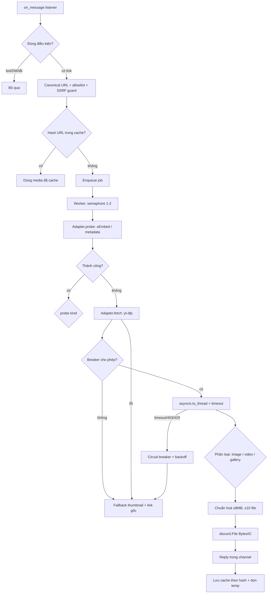

# Thiết kế: link social media → ảnh/video trong Discord

> Tài liệu **thiết kế**, chưa implement. Mục tiêu: bot tự nhận link TikTok / X /
> Instagram / Facebook do người dùng gửi và trả đúng ảnh hoặc video.

---

## 1. Sự thật cần nhớ trước

| Câu hỏi | Trả lời | Bằng chứng |
|---|---|---|
| Bot có sửa được tin nhắn của user để thay link bằng video không? | **Không.** | discord.py: `Permissions.manage_messages` — *"there are currently no ways to edit other people's messages"*; `Message.edit()` trả `Forbidden` nếu sửa message không phải của mình |
| Bot có tự unfurl link được không? | Discord tự làm qua oEmbed; bot không chiếm quyền đó | API Discord không có endpoint "edit embed của user" |
| Vậy bot làm được gì? | Gửi **message mới** (reply) kèm `discord.File`/embed; hoặc xoá message user rồi gửi lại nếu có `Manage Messages` | `Messageable.send`, `Message.delete`, `suppress_embeds` |
| Giới hạn file/embed? | 8 MB/file (bot thường), tối đa ~10 attachment, embed 6000 ký tự / 25 field / 1024 giá trị | discord.py + Discord API docs |
| yt-dlp có chạy 100% mọi link không? | **Không.** Tài liệu yt-dlp cảnh báo sites thay đổi liên tục, cách duy nhất để biết là thử | `devscripts/make_supportedsites.py` |

**Kết luận:** đây là tính năng "tốt khi chạy, nhưng phải suy thoái duyên dáng". Không bao giờ để một link hỏng làm crash bot.

---

## 2. Kiến trúc đề xuất



---

## 3. Các thành phần

### 3.1 `LinkGuard` — cổng vào

- Regex phát hiện URL (`https?://...`), tối đa **3 link/message**.
- Chuẩn hoá: lowercase host, bỏ `www.`, bỏ tracking params (`utm_*`, `igshid`, `s=`), resolve shortlink với **tối đa 3 redirect** và timeout.
- **Allowlist mặc định rỗng** — admin phải bật domain. Chặn IP private/loopback/link-local để tránh SSRF.
- Cache key = `sha256(canonical_url)`; **không log URL đầy** (có thể chứa token/private code).

### 3.2 `MediaAdapter` — interface chung

```python
class MediaAdapter(Protocol):
    domains: tuple[str, ...]
    priority: int

    async def probe(self, url: str) -> ProbeResult: ...
    async def fetch(self, url: str) -> MediaBundle: ...
```

| Adapter | `probe()` | `fetch()` | Ghi chú |
|---|---|---|---|
| `OfficialOEmbed` | gọi oEmbed công khai, lấy `type`, `title`, `thumbnail_url` | chỉ trả ảnh/embed | rẻ, an toàn nhất |
| `YtDlpAdapter` | `extract_info(download=False)` lấy `_type`, `duration`, `ext`, `formats`, `thumbnails` | `extract_info(download=True)` với `outtmpl`, `format`, `logger` | mạnh nhưng dễ vỡ; cần probe thực tế |
| `ThumbnailFallback` | — | lấy ảnh thumbnail/public image | luôn có để fallback cuối |

Mỗi adapter có **circuit breaker riêng** (`net.get_breaker("tiktok")`, `"instagram"`, …) để một site chết không kéo site khác.

### 3.3 `MediaClassifier` — trả "đúng ảnh hoặc video"

Dùng field từ `info_dict`/oEmbed:

| Kết quả | Điều kiện | Hành động |
|---|---|---|
| `image` | oEmbed `type=photo`, hoặc info có `ext` ảnh, không có `vcodec` | gửi 1 `discord.File` |
| `video` | có `vcodec` / `duration` / `format` video | chọn format nhỏ nhất có video+audio, ≤8MB |
| `gallery` | có `image_urls`/`thumbnails` nhiều phần (carousel Instagram/TikTok photo post) | gửi tối đa 10 ảnh |
| `none` | không xác định được | fallback thumbnail + link gốc |

Nếu video > 8MB: FFmpeg transcode với budget (ví dụ 720p, 1.2 Mbps, tối đa 45s). Vẫn vượt → gửi thumbnail + link.

### 3.4 `MediaWorker` — luồng bất đồng bộ

- `asyncio.Queue` + `Semaphore(1–2)` → không tải nhiều link cùng lúc.
- `asyncio.to_thread()` cho yt-dlp/FFmpeg (blocking), bọc `asyncio.wait_for(..., 20–30s)`.
- `tempfile.TemporaryDirectory()` + `finally: cleanup` — không để rác trên Pi.
- Dedupe theo hash: cùng 1 link trong TTL không tải lại.

### 3.5 `DeliveryPolicy`

| Chế độ | Hành vi | Rủi ro |
|---|---|---|
| `reply` (mặc định) | reply message mới kèm media | an toàn, không cần quyền đặc biệt |
| `replace` | xoá message user rồi gửi lại | cần `Manage Messages`; ghi audit; **opt-in từng guild** |

Không bao giờ mặc định `replace`.

---

## 4. Ma trận suy thoái

| Tình huống | Bot làm gì |
|---|---|
| Domain không trong allowlist | Bỏ qua hoàn toàn |
| Shortlink redirect về IP private | Chặn, log hash, bỏ qua |
| oEmbed trả `type=photo` | Gửi thumbnail/embed ngay |
| yt-dlp hỏng extractor | Breaker mở → fallback thumbnail + link |
| Video > 8MB | Transcode; nếu vẫn to → thumbnail + link |
| 403/429 từ platform | Backoff jitter, tạm quarantine domain |
| Rate limit Discord | discord.py tự xử lý; worker giới hạn concurrency |
| Link NSFW trong kênh thường | Không tải, nhắc chuyển kênh NSFW |
| Bot bị spam link | Cooldown per-user + max 3 link/message |

---

## 5. Cấu hình đề xuất

| Biến | Mặc định | Ý nghĩa |
|---|---|---|
| `ZENE_MEDIA_LINKS_ENABLED` | `false` | Bật/tắt toàn tính năng |
| `ZENE_MEDIA_ALLOWED_DOMAINS` | rỗng | Danh sách domain được phép |
| `ZENE_MEDIA_MODE` | `reply` | `reply` hoặc `replace` |
| `ZENE_MEDIA_MAX_LINKS` | `3` | Số link tối đa mỗi message |
| `ZENE_MEDIA_MAX_BYTES` | `8388608` | Giới hạn file (theo Discord) |
| `ZENE_MEDIA_TIMEOUT` | `25` | Timeout tải một link |
| `ZENE_MEDIA_CACHE_TTL` | `3600` | TTL cache theo hash URL |
| `ZENE_MEDIA_WORKERS` | `1` | Số worker tải cùng lúc |

---

## 6. Pháp lý & quyền riêng tư

- Tải và đăng lại video YouTube/Instagram/TikTok/Facebook thường **vi phạm ToS** của các nền tảng và có thể vi phạm bản quyền. Đây là rủi ro **chính sách**, không phải lỗi code.
- X API hiện **pay-per-use** (docs.x.com), nên oEmbed/third-party là lựa chọn thực tế hơn cho link X.
- Tài liệu TikTok bị chặn từ mạng này → khả năng oEmbed TikTok là **unknown**, cần verify lại trước khi implement.
- Mặc định **tắt**, bật theo guild, có disclaimer trong README, và cung cấp cơ chế opt-out cho user.

---

## 7. Lộ trình triển khai

1. **Phase 0 — đo lường:** chỉ log số link thấy được, chưa tải gì.
2. **Phase 1 — oEmbed only:** `/medialink <url>` opt-in, gửi embed thumbnail.
3. **Phase 2 — yt-dlp có allowlist:** thêm adapter, worker, breaker, transcode, cache.
4. **Phase 3 — auto trong channel đã bật:** `ZENE_MEDIA_LINKS_ENABLED=true` + chế độ `reply`.
5. **Phase 4 — replace (tuỳ chọn):** chỉ khi có `Manage Messages` và admin xác nhận.

Mỗi phase đều có feature flag để rollback ngay.

---

## 8. Bài học từ Embedded.gallery (https://embedded.gallery/)

Bot này là **embed fixer**, không phải downloader. Điểm khác biệt lớn:

| Học được | Áp dụng vào ZENE |
|---|---|
| Không tải lại media rồi upload — dùng URL media từ nền tảng trong `Embed` | Đổi ưu tiên: **oEmbed/remote URL trước**, yt-dlp chỉ làm fallback. Tránh giới hạn 8MB và rủi ro rehost |
| 2 chế độ: `Reply` (mặc định) và `Impersonate` (webhook mang tên/avatar người gửi, có watermark trừ khi Premium) | Thêm tuỳ chọn webhook, nhưng mặc định vẫn `reply` cho an toàn |
| "Ẩn preview của Discord rồi reply embed đã sửa" → nhiều khả năng dùng `Message.edit(suppress=True)`, cần `Manage Messages` | Thêm `suppress` có điều kiện theo quyền, fallback reply nếu thiếu quyền |
| Modifier ngay trong tin nhắn: `文` dịch, `~` ẩn quote, `||` spoiler, `^` hiện parent reply, `es:` chọn ngôn ngữ | Thiết kế cú pháp điều khiển per-link thay vì chỉ env cứng |
| Cấu hình theo server + channel + platform; NSFW/spoiler auto theo kênh age-restricted | Mở rộng config hiện tại theo guild/channel |
| Context: quote, parent reply, Community Notes, comment Reddit cụ thể | Adapter nên trả `context` chứ không chỉ media |
| Gallery view: ảnh + video của cùng 1 post trong 1 gallery | Dùng nhiều embed/file trong 1 message thay vì chỉ 1 file |
| Dịch tự động theo server/channel | Tái dùng `to_vietnamese()` hiện có |
| Freemium $1.99/server/tháng cho custom avatar, bỏ watermark, bot phản hồi bot, translation limit cao | Gợi ý mô hình bền vững nếu public bot |

**Lưu ý:** trang không công bố implementation, nên chi tiết kỹ thuật ở trên là *inferred* từ mô tả sản phẩm. Privacy policy của họ nói chỉ lưu Discord ID để debug và xử lý nội dung tin nhắn tạm thời — nên cân nhắc chính sách tương tự.

**Kết luận sửa thiết kế:** ưu tiên `embed fixer` (remote URL) hơn `downloader`. yt-dlp vẫn giữ làm fallback cho link không có oEmbed tốt.

## 10. Cách code cho đúng (đã kiểm tra API discord.py 2.7)

### 10.1 Kiểu dữ liệu

```python
from dataclasses import dataclass, field
from typing import Literal

@dataclass(frozen=True, slots=True)
class LinkContext:
    message: discord.Message
    url: str
    canonical: str
    modifiers: frozenset[str] = field(default_factory=frozenset)
    lang: str | None = None

@dataclass(frozen=True, slots=True)
class ProbeResult:
    kind: Literal["image", "video", "gallery", "none"]
    title: str
    author: str
    media_urls: tuple[str, ...]          # URL từ CDN của nền tảng
    context: str = ""                    # quote / parent / community note
    nsfw: bool = False
```

`media_urls` là **URL từ nền tảng**, không phải file tải về — đây là khác biệt lớn nhất
so với thiết kế yt-dlp ban đầu.

### 10.2 Parser modifier

```python
MOD_MAP = {"文": "translate", "~": "hide_quote", "||": "spoiler", "^": "parent"}
LANG = re.compile(r"^([a-z]{2}):", re.I)

def parse_modifiers(text: str) -> tuple[str, frozenset[str], str | None]:
    mods: set[str] = set()
    lang = None
    match = LANG.match(text)
    if match:
        lang = match.group(1).lower()
        text = text[match.end():]
    for token, name in MOD_MAP.items():
        if token in text:
            mods.add(name)
            text = text.replace(token, "")
    return text.strip(), frozenset(mods), lang
```

Chạy parser **trước** khi canonical hoá URL. Không dùng regex tham lam nuốt cả câu.

### 10.3 Dựng gallery bằng Components V2 (API đã verify tồn tại)

```python
def build_gallery(result: ProbeResult, spoiler: bool) -> discord.ui.LayoutView:
    view = discord.ui.LayoutView(timeout=180)
    container = discord.ui.Container(accent_colour=discord.Colour.blurple())
    container.add_item(
        discord.ui.TextDisplay(f"**{result.title}** — {result.author}"[:4096])
    )
    if result.context:
        container.add_item(discord.ui.TextDisplay(result.context[:4096]))

    gallery = discord.ui.MediaGallery()
    for url in result.media_urls[:10]:          # MediaGallery tối đa 10 item
        gallery.add_item(media=url, spoiler=spoiler)
    container.add_item(gallery)
    view.add_item(container)
    return view
```

Đã kiểm tra: `Container.add_item`, `LayoutView.add_item`, `MediaGallery.add_item`,
`TextDisplay` đều tồn tại; `MediaGallery.add_item` nhận `media=str|discord.File` và
`spoiler=bool`, ném `ValueError` nếu quá 10 item.

> **Không trộn** `embed=` / `content=` với `view=LayoutView` (Components V2) — inferred,
> cần smoke test khi implement.

### 10.4 Ẩn preview của message gốc

```python
async def suppress_preview(message: discord.Message) -> bool:
    guild = message.guild
    if guild is None or not message.channel.permissions_for(guild.me).manage_messages:
        return False
    try:
        await message.edit(suppress=True)
        return True
    except (discord.Forbidden, discord.HTTPException):
        return False
```

`suppress=True` **yêu cầu Manage Messages** (đã verify trong docs `Message.edit`).
Không có quyền thì cứ reply bình thường.

### 10.5 Chế độ Impersonate (webhook)

```python
async def send_impersonated(
    bot, channel, author, view
) -> None:
    webhook = await channel.create_webhook(name="zene-embed")  # cần Manage Webhooks
    try:
        await webhook.send(
            username=author.display_name,
            avatar_url=author.display_avatar.url,
            view=view,
            wait=True,
        )
    finally:
        await webhook.delete()
```

Có thể cache webhook theo channel thay vì tạo/xoá mỗi lần. Webhook trả về tin nhắn
**mới** mang tên người gửi — vẫn không sửa được message gốc.

### 10.6 Luồng xử lý tổng hợp

```python
async def on_message(message):
    if not cfg.enabled or message.author.bot or message.guild is None:
        return
    links = LINK_RE.findall(message.content)
    if not links or len(links) > cfg.max_links:
        return
    for raw in links:
        text, mods, lang = parse_modifiers(raw)
        ctx = LinkContext(message, raw, canonical(raw), mods, lang)
        await QUEUE.put(ctx)          # không await download ở đây
```

Worker: `probe()` → nếu có `media_urls` → `build_gallery()` ngay; nếu không →
`fetch()` (yt-dlp trong `asyncio.to_thread` + `wait_for`) → build → `suppress` →
reply/webhook → cache hash.

### 10.7 Checklist nghiệm thu

- [ ] Unit test `parse_modifiers` với `文 es: http://... ||`, `~`, `^`.
- [ ] Unit test classifier: `image`, `video`, `gallery`, `none`.
- [ ] Smoke test `build_gallery(...).to_components()` — đảm bảo ≤10 item (đã thử: 1 container, 3 child, 2 gallery item).
- [ ] Test `suppress_preview` khi bot thiếu Manage Messages → trả `False`, không crash.
- [ ] Test breaker mở sau 3 lỗi, fallback vẫn gửi link gốc.
- [ ] Test không log URL đầy (chỉ hash).
- [ ] Test temp dir được dọn trong `finally`.

## 11. Câu hỏi còn mở

- TikTok oEmbed có trả thumbnail miễn phí không? (docs bị chặn → **unknown**)
- Instagram/Facebook cần cookie đăng nhập cho bài public không? (**inferred**: có thể, tuỳ thời điểm)
- Có nên dùng webhook để "giả user" gửi lại không? (vẫn là message mới, chỉ khác tên hiển thị; **không giải quyết** việc sửa message gốc)
- Có nên transcode bằng FFmpeg ngay trên Pi 4 không? (ARM có wheel/ffmpeg static, nhưng CPU hạn chế → cần budget nghiêm ngặt)
