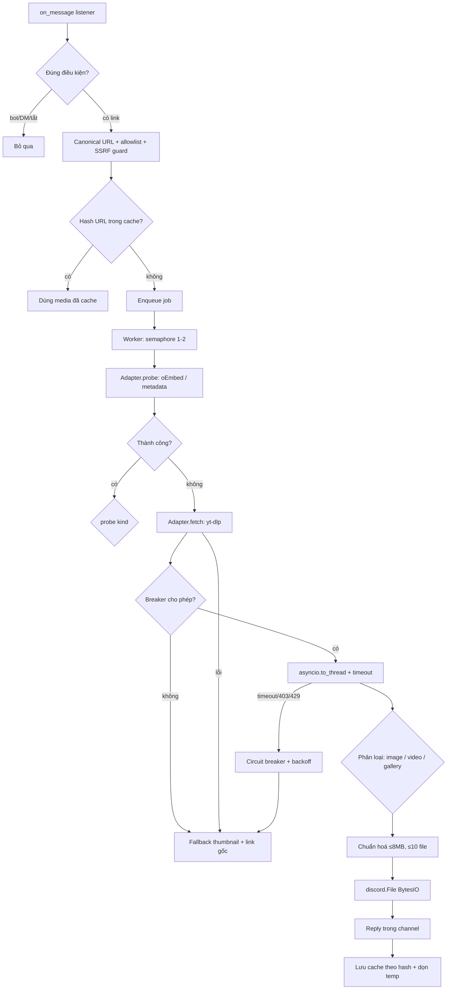

# Thiết kế: link social media → ảnh/video trong Discord

> Tài liệu **thiết kế**, chưa implement. Mục tiêu: bot tự nhận link TikTok / X /
> Instagram / Facebook do người dùng gửi và trả đúng ảnh hoặc video.

---

## 1. Sự thật cần nhớ trước

| Câu hỏi | Trả lời | Bằng chứng |
|---|---|---|
| Bot có sửa được tin nhắn của user để thay link bằng video không? | **Không.** | discord.py: `Permissions.manage_messages` — *"there are currently no ways to edit other people's messages"*; `Message.edit()` trả `Forbidden` nếu sửa message không phải của mình |
| Bot có tự unfurl link được không? | Discord tự làm qua oEmbed; bot không chiếm quyền đó | API Discord không có endpoint "edit embed của user" |
| Vậy bot làm được gì? | Gửi **message mới** (reply) kèm `discord.File`/embed; hoặc xoá message user rồi gửi lại nếu có `Manage Messages` | `Messageable.send`, `Message.delete`, `suppress_embeds` |
| Giới hạn file/embed? | 8 MB/file (bot thường), tối đa ~10 attachment, embed 6000 ký tự / 25 field / 1024 giá trị | discord.py + Discord API docs |
| yt-dlp có chạy 100% mọi link không? | **Không.** Tài liệu yt-dlp cảnh báo sites thay đổi liên tục, cách duy nhất để biết là thử | `devscripts/make_supportedsites.py` |

**Kết luận:** đây là tính năng "tốt khi chạy, nhưng phải suy thoái duyên dáng". Không bao giờ để một link hỏng làm crash bot.

---

## 2. Kiến trúc đề xuất



---

## 3. Các thành phần

### 3.1 `LinkGuard` — cổng vào

- Regex phát hiện URL (`https?://...`), tối đa **3 link/message**.
- Chuẩn hoá: lowercase host, bỏ `www.`, bỏ tracking params (`utm_*`, `igshid`, `s=`), resolve shortlink với **tối đa 3 redirect** và timeout.
- **Allowlist mặc định rỗng** — admin phải bật domain. Chặn IP private/loopback/link-local để tránh SSRF.
- Cache key = `sha256(canonical_url)`; **không log URL đầy** (có thể chứa token/private code).

### 3.2 `MediaAdapter` — interface chung

```python
class MediaAdapter(Protocol):
    domains: tuple[str, ...]
    priority: int

    async def probe(self, url: str) -> ProbeResult: ...
    async def fetch(self, url: str) -> MediaBundle: ...
```

| Adapter | `probe()` | `fetch()` | Ghi chú |
|---|---|---|---|
| `OfficialOEmbed` | gọi oEmbed công khai, lấy `type`, `title`, `thumbnail_url` | chỉ trả ảnh/embed | rẻ, an toàn nhất |
| `YtDlpAdapter` | `extract_info(download=False)` lấy `_type`, `duration`, `ext`, `formats`, `thumbnails` | `extract_info(download=True)` với `outtmpl`, `format`, `logger` | mạnh nhưng dễ vỡ; cần probe thực tế |
| `ThumbnailFallback` | — | lấy ảnh thumbnail/public image | luôn có để fallback cuối |

Mỗi adapter có **circuit breaker riêng** (`net.get_breaker("tiktok")`, `"instagram"`, …) để một site chết không kéo site khác.

### 3.3 `MediaClassifier` — trả "đúng ảnh hoặc video"

Dùng field từ `info_dict`/oEmbed:

| Kết quả | Điều kiện | Hành động |
|---|---|---|
| `image` | oEmbed `type=photo`, hoặc info có `ext` ảnh, không có `vcodec` | gửi 1 `discord.File` |
| `video` | có `vcodec` / `duration` / `format` video | chọn format nhỏ nhất có video+audio, ≤8MB |
| `gallery` | có `image_urls`/`thumbnails` nhiều phần (carousel Instagram/TikTok photo post) | gửi tối đa 10 ảnh |
| `none` | không xác định được | fallback thumbnail + link gốc |

Nếu video > 8MB: FFmpeg transcode với budget (ví dụ 720p, 1.2 Mbps, tối đa 45s). Vẫn vượt → gửi thumbnail + link.

### 3.4 `MediaWorker` — luồng bất đồng bộ

- `asyncio.Queue` + `Semaphore(1–2)` → không tải nhiều link cùng lúc.
- `asyncio.to_thread()` cho yt-dlp/FFmpeg (blocking), bọc `asyncio.wait_for(..., 20–30s)`.
- `tempfile.TemporaryDirectory()` + `finally: cleanup` — không để rác trên Pi.
- Dedupe theo hash: cùng 1 link trong TTL không tải lại.

### 3.5 `DeliveryPolicy`

| Chế độ | Hành vi | Rủi ro |
|---|---|---|
| `reply` (mặc định) | reply message mới kèm media | an toàn, không cần quyền đặc biệt |
| `replace` | xoá message user rồi gửi lại | cần `Manage Messages`; ghi audit; **opt-in từng guild** |

Không bao giờ mặc định `replace`.

---

## 4. Ma trận suy thoái

| Tình huống | Bot làm gì |
|---|---|
| Domain không trong allowlist | Bỏ qua hoàn toàn |
| Shortlink redirect về IP private | Chặn, log hash, bỏ qua |
| oEmbed trả `type=photo` | Gửi thumbnail/embed ngay |
| yt-dlp hỏng extractor | Breaker mở → fallback thumbnail + link |
| Video > 8MB | Transcode; nếu vẫn to → thumbnail + link |
| 403/429 từ platform | Backoff jitter, tạm quarantine domain |
| Rate limit Discord | discord.py tự xử lý; worker giới hạn concurrency |
| Link NSFW trong kênh thường | Không tải, nhắc chuyển kênh NSFW |
| Bot bị spam link | Cooldown per-user + max 3 link/message |

---

## 5. Cấu hình đề xuất

| Biến | Mặc định | Ý nghĩa |
|---|---|---|
| `ZENE_MEDIA_LINKS_ENABLED` | `false` | Bật/tắt toàn tính năng |
| `ZENE_MEDIA_ALLOWED_DOMAINS` | rỗng | Danh sách domain được phép |
| `ZENE_MEDIA_MODE` | `reply` | `reply` hoặc `replace` |
| `ZENE_MEDIA_MAX_LINKS` | `3` | Số link tối đa mỗi message |
| `ZENE_MEDIA_MAX_BYTES` | `8388608` | Giới hạn file (theo Discord) |
| `ZENE_MEDIA_TIMEOUT` | `25` | Timeout tải một link |
| `ZENE_MEDIA_CACHE_TTL` | `3600` | TTL cache theo hash URL |
| `ZENE_MEDIA_WORKERS` | `1` | Số worker tải cùng lúc |

---

## 6. Pháp lý & quyền riêng tư

- Tải và đăng lại video YouTube/Instagram/TikTok/Facebook thường **vi phạm ToS** của các nền tảng và có thể vi phạm bản quyền. Đây là rủi ro **chính sách**, không phải lỗi code.
- X API hiện **pay-per-use** (docs.x.com), nên oEmbed/third-party là lựa chọn thực tế hơn cho link X.
- Tài liệu TikTok bị chặn từ mạng này → khả năng oEmbed TikTok là **unknown**, cần verify lại trước khi implement.
- Mặc định **tắt**, bật theo guild, có disclaimer trong README, và cung cấp cơ chế opt-out cho user.

---

## 7. Lộ trình triển khai

1. **Phase 0 — đo lường:** chỉ log số link thấy được, chưa tải gì.
2. **Phase 1 — oEmbed only:** `/medialink <url>` opt-in, gửi embed thumbnail.
3. **Phase 2 — yt-dlp có allowlist:** thêm adapter, worker, breaker, transcode, cache.
4. **Phase 3 — auto trong channel đã bật:** `ZENE_MEDIA_LINKS_ENABLED=true` + chế độ `reply`.
5. **Phase 4 — replace (tuỳ chọn):** chỉ khi có `Manage Messages` và admin xác nhận.

Mỗi phase đều có feature flag để rollback ngay.

---

## 8. Câu hỏi còn mở

- TikTok oEmbed có trả thumbnail miễn phí không? (docs bị chặn → **unknown**)
- Instagram/Facebook cần cookie đăng nhập cho bài public không? (**inferred**: có thể, tuỳ thời điểm)
- Có nên dùng webhook để "giả user" gửi lại không? (vẫn là message mới, chỉ khác tên hiển thị; **không giải quyết** việc sửa message gốc)
- Có nên transcode bằng FFmpeg ngay trên Pi 4 không? (ARM có wheel/ffmpeg static, nhưng CPU hạn chế → cần budget nghiêm ngặt)
